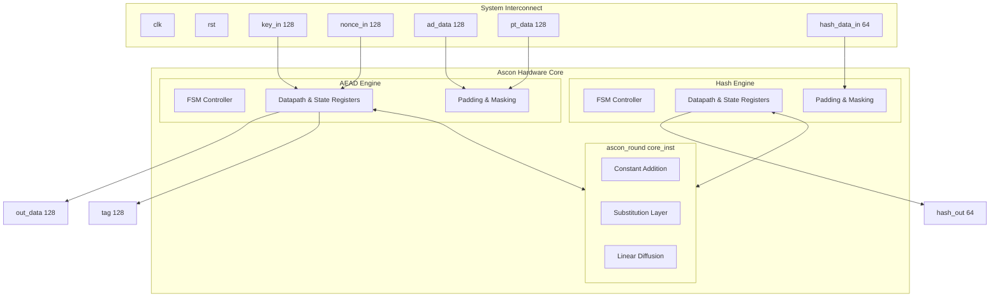
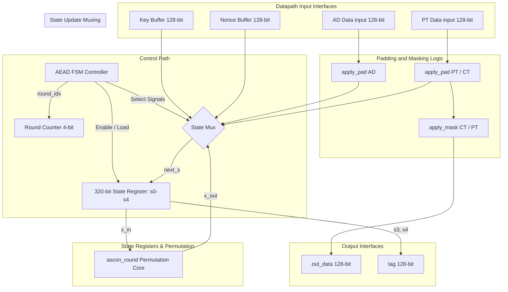
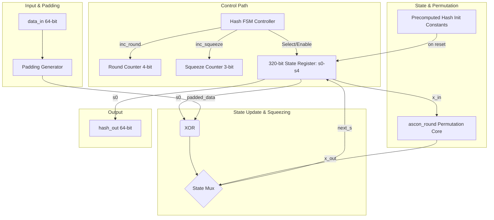
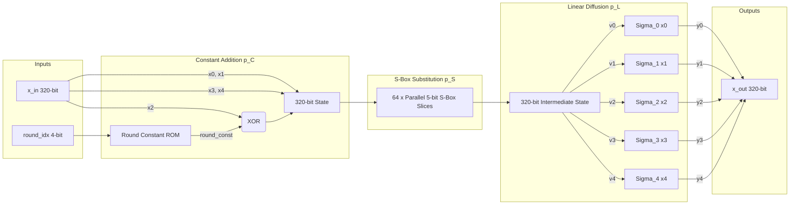
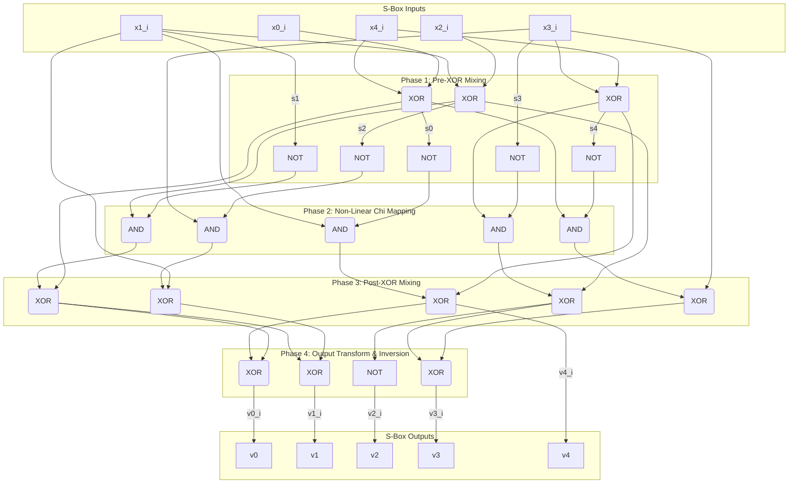
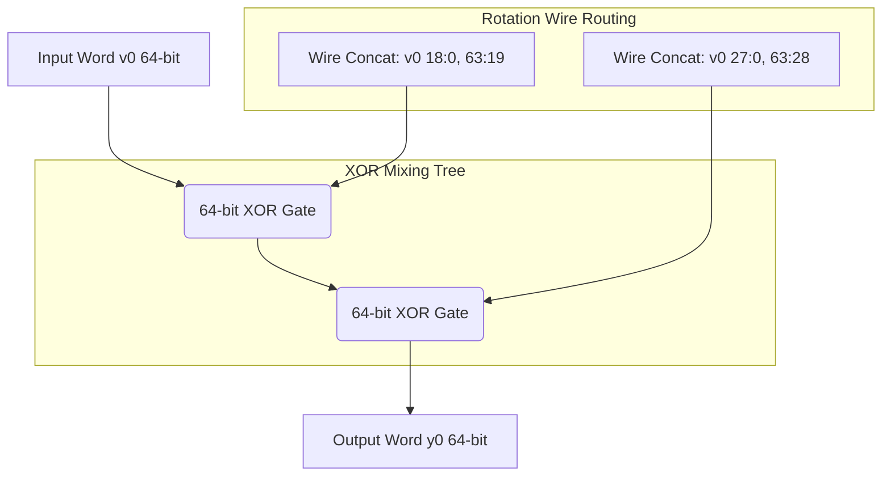
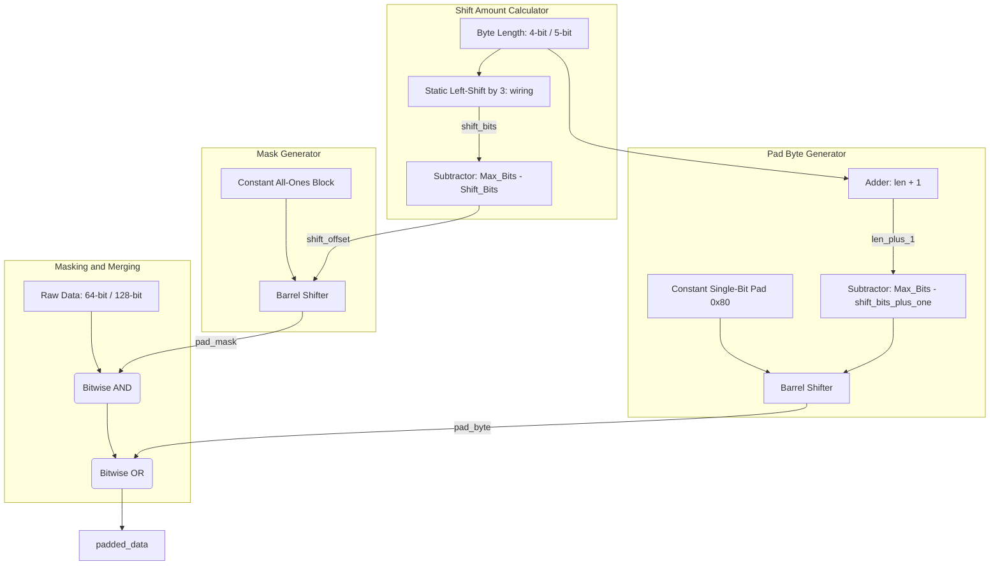

# Ascon Hardware Block Design Guide

This document provides the hardware block designs for **Ascon-128a** (AEAD Encryption/Decryption) and **Ascon-Hash256**, spanning from high-level system blocks down to individual gate-level operator connections.

---

## 1. High-Level System Block Diagram
The Ascon IP core contains two main modules sharing a single clock and reset domain: `ascon_aead` for authenticated encryption/decryption and `ascon_hash` for hashing. Both modules reuse the same combinational permutation core (`ascon_round`).

---

## 2. Module-Level Block Designs

### 2.1. Ascon AEAD (`ascon_aead`)
The AEAD module consists of a control path (Finite State Machine) and a datapath containing the 320-bit state registers, key/nonce buffers, and the padding/masking circuits.

---

### 2.2. Ascon Hash (`ascon_hash`)
The Hash module uses 64-bit rate blocks. It preloads a constant precomputed initialization state on reset, avoiding 12 clock cycles of initial permutation.

---

## 3. Permutation Round Datapath (`ascon_round`)
The core permutation module is fully combinational, processing the 320-bit state in a single clock cycle.

---

## 4. Operator-Level Logic Designs

### 4.1. Gate-Level S-Box Slice ($p_S$)
The S-box processes a single bit slice $i$ ($0 \le i < 64$) across the 5 state words. 64 identical copies of this circuit run in parallel.

---

### 4.2. Linear Diffusion Operators ($p_L$)
The linear diffusion layer consists of 5 word-level channels. It uses wire swizzling for rotations and an XOR tree to mix them.

#### Word 0 Diffusion Block ($x_0$):
$$\Sigma_0(x_0) = x_0 \oplus (x_0 \ggg 19) \oplus (x_0 \ggg 28)$$

*(Note: Words $x_1$ through $x_4$ use identical XOR mixing tree architectures, but with different hardwired rotation tap-offs).*

---

### 4.3. Padding Generator Operator
The padding generator formats incoming messages to fit block boundaries. It takes raw data and a length parameter to output a padded block and valid bitmask.

*   **Adder:** Computes `len + 1` to locate the padding boundary.
*   **Subtractors:** Compute `Max_Bits - (len * 8)` and `Max_Bits - ((len + 1) * 8)` to define the shift offsets.
*   **Barrel Shifters:** Perform variable shifts based on the computed shift offsets to align the mask and padding byte.
*   **AND/OR Operators:** Apply the mask and insert the pad bit into the data stream.
