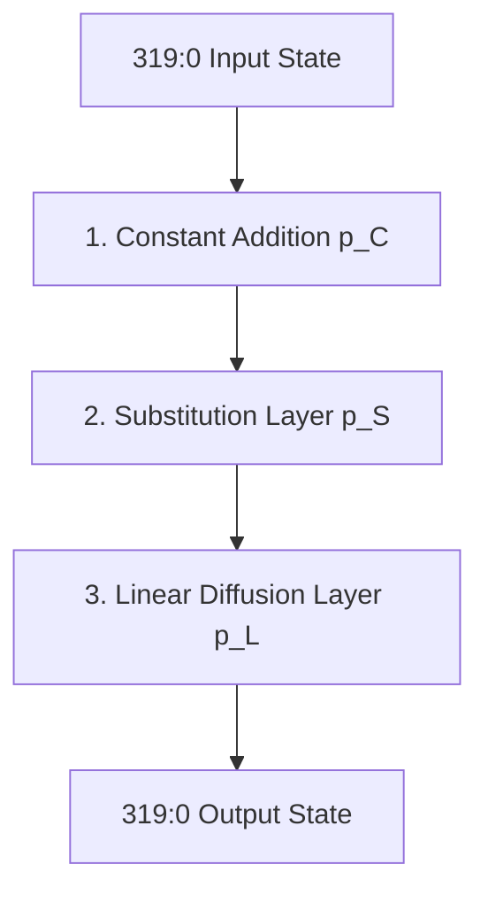
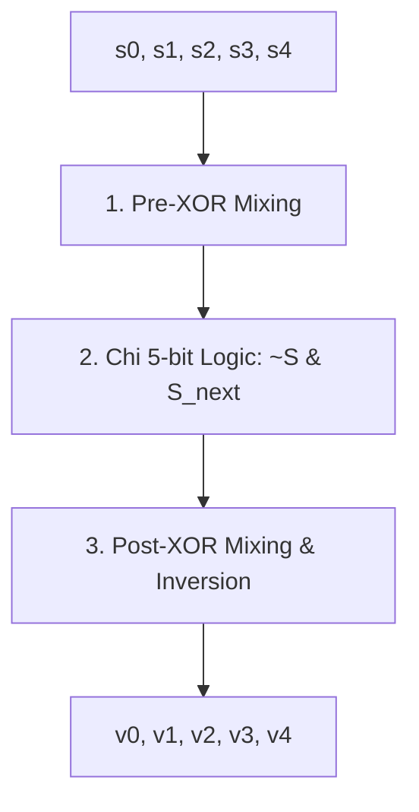
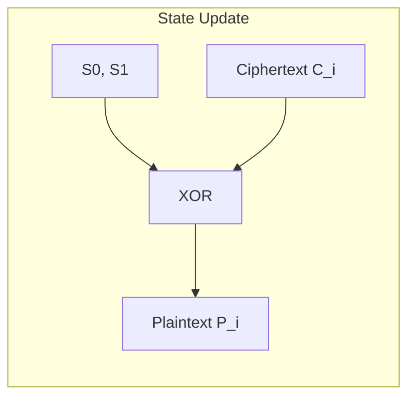

# Hardware Operator and Logic Guide for Ascon-128a and Ascon-Hash256

This document provides a detailed breakdown of the mathematical, logical, and hardware operators used in the **Ascon-128a** (AEAD Encryption/Decryption) and **Ascon-Hash256** implementations. It traces every operation down to its primitive gate level, explaining how they are realized in software (Python reference) and hardware (Verilog RTL).

---

## 1. Introduction to the Ascon State
Ascon operates on a **320-bit state** $S$, which is divided into five 64-bit registers:
$$S = \{x_0, x_1, x_2, x_3, x_4\}$$
Each register $x_i$ is a 64-bit unsigned integer (word), ordered from top ($x_0$) to bottom ($x_4$).

---

## 2. Core Permutation Round Operators
The core permutation $p$ consists of $12$ rounds (for initialization, finalization, and hash squeezing) or $8$ rounds (for intermediate steps in AEAD). Each round contains three sequential layers: Constant Addition, Substitution (S-box), and Linear Diffusion.



### 2.1. Constant Addition ($p_C$)
In each round, a round constant $c_r$ (an 8-bit value) is added to the middle word $x_2$.

#### Operators Used:
*   **Bitwise XOR (`^`)**: This is the only operator used for "addition" here. In cryptography, addition in the Galois Field $\text{GF}(2)$ is represented by the bitwise XOR operator.
*   **Constant Selector (LUT / ROM)**: The round constant $c_r$ is determined based on the round index (`round_ctr`).

#### Hardware vs. Software Implementation:
*   **Python:**
    ```python
    S[2] ^= (0xf0 - r*0x10 + r*0x1)
    ```
    In Python, the round constant is computed dynamically using arithmetic subtraction (`-`) and multiplication (`*`), and then applied via XOR.
*   **Verilog:**
    ```verilog
    always @(*) begin
        case(round_idx)
            4'd0:  round_const = 8'hf0;
            4'd1:  round_const = 8'he1;
            // ...
            4'd11: round_const = 8'h4b;
            default: round_const = 8'h00;
        endcase
    end
    assign x2_c = x2 ^ {56'd0, round_const};
    ```
    *   **Multiplier/Adder Status:** **None.** The hardware implementation precomputes all constants into a read-only lookup table (multiplexer/case statement). No arithmetic multiplication or subtraction is performed at runtime.
    *   **XOR Gate Cost:** Exactly 8 XOR gates (since only the lowest 8 bits of $x_2$ are XORed with `round_const`, and the upper 56 bits are wired straight through).

---

### 2.2. Substitution Layer ($p_S$)
Ascon uses a 5-bit S-box applied bit-sliced horizontally across the five 64-bit words. For each bit position $0 \le i < 64$, the S-box takes a 5-bit input vector $(x_{0,i}, x_{1,i}, x_{2,i}, x_{3,i}, x_{4,i})$ and produces a 5-bit output vector.

The S-box is implemented entirely using bitwise boolean logic operators:



#### Operators Used:
1.  **Bitwise XOR (`^`)**: Mixes the linear input states.
2.  **Bitwise NOT (`~`)**: Inverts state bits to provide non-linearity.
3.  **Bitwise AND (`&`)**: Combines states to achieve algebraic degree 2 (non-linearity).

#### Execution Steps (RTL Breakdown):
```verilog
// 1. Pre-XOR Mixing
assign s0 = x0 ^ x4;
assign s1 = x1;
assign s2 = x2_c ^ x1;
assign s3 = x3;
assign s4 = x4 ^ x3;

// 2. Chi Non-Linear Transformation: T[i] = (~S[i]) & S[i+1]
assign t0 = (~s0) & s1;
assign t1 = (~s1) & s2;
assign t2 = (~s2) & s3;
assign t3 = (~s3) & s4;
assign t4 = (~s4) & s0;

// S[i] ^= T[i+1]
assign u0 = s0 ^ t1;
assign u1 = s1 ^ t2;
assign u2 = s2 ^ t3;
assign u3 = s3 ^ t4;
assign u4 = s4 ^ t0;

// 3. Post-XOR Mixing & Inversion
assign v1 = u1 ^ u0;
assign v0 = u0 ^ u4;
assign v3 = u3 ^ u2;
assign v2 = ~u2; // Bitwise NOT (Inversion)
assign v4 = u4;
```

#### Hardware vs. Software Implementation:
*   **Multiplier/Adder Status:** **None.** The S-box is fully combinational and side-channel resistant because it does not use arithmetic adders or multipliers that generate carry chains.
*   **Gate Count (per bit-slice):**
    *   XOR: 8 gates
    *   AND: 5 gates
    *   NOT: 6 gates (including the final inversion of $v_2$)
*   **Total State Gate Cost (64-bit width):** 512 XOR gates, 320 AND gates, and 384 NOT gates.

---

### 2.3. Linear Diffusion Layer ($p_L$)
The linear diffusion layer provides diffusion within each 64-bit word by mixing the word with two rotated copies of itself.
$$\Sigma_0(x_0) = x_0 \oplus (x_0 \ggg 19) \oplus (x_0 \ggg 28)$$
$$\Sigma_1(x_1) = x_1 \oplus (x_1 \ggg 61) \oplus (x_1 \ggg 39)$$
$$\Sigma_2(x_2) = x_2 \oplus (x_2 \ggg 1) \oplus (x_2 \ggg 6)$$
$$\Sigma_3(x_3) = x_3 \oplus (x_3 \ggg 10) \oplus (x_3 \ggg 17)$$
$$\Sigma_4(x_4) = x_4 \oplus (x_4 \ggg 7) \oplus (x_4 \ggg 41)$$

#### Operators Used:
*   **Circular Rotation ($\ggg$) / Shifting**: Shifts the bits of the word to the right, wrapping the shifted-out bits back to the left.
*   **Bitwise XOR (`^`)**: Mixes the original word with its rotated variants.

#### Hardware vs. Software Implementation:
*   **Python (Software):**
    Software lacks a native circular rotation operator. It must simulate circular rotation using logical right shifts (`>>`), logical left shifts (`<<`), bitwise OR (`|`), and bitwise masking:
    ```python
    def rotr(val: int, r: int) -> int:
        return (val >> r) | ((val & (1<<r)-1) << (64-r))
    ```
    This involves:
    *   **Adders/Subtractors:** `64 - r` (subtraction to compute the left-shift offset).
    *   **Shifters:** Two shifts (`>> r` and `<< (64-r)`).
    *   **Bitwise Logic:** One AND (`&`) for masking, one OR (`|`) to merge.
*   **Verilog (Hardware):**
    Because the rotation amounts are fixed constants (19, 28, 61, etc.), no shifting logic gates are needed. Rotation is achieved purely via **wire swizzling / concatenation**:
    ```verilog
    assign y0 = v0 ^ {v0[18:0], v0[63:19]} ^ {v0[27:0], v0[63:28]};
    assign y1 = v1 ^ {v1[60:0], v1[63:61]} ^ {v1[38:0], v1[63:39]};
    assign y2 = v2 ^ {v2[0:0],  v2[63:1]}  ^ {v2[5:0],  v2[63:6]};
    assign y3 = v3 ^ {v3[9:0],  v3[63:10]} ^ {v3[16:0], v3[63:17]};
    assign y4 = v4 ^ {v4[6:0],  v4[63:7]}  ^ {v4[40:0], v4[63:41]};
    ```
    *   **Multiplier/Adder/Shifter Status:** **Zero.** The concatenation `{}` operator does not translate to logic gates. It is compiled as direct physical wiring on silicon or FPGA routing tracks.
    *   **Logic Gates Cost:** Exactly $2 \times 64 = 128$ XOR gates per word. For the whole 5-word state, this requires $640$ XOR gates.

---

## 3. Operator Breakdown by Algorithm

```
+--------------------------------------------------------------------------------+
|                                    ASCON                                       |
+-----------------------+--------------------------------+-----------------------+
|        HASH           |           ENCRYPTION           |       DECRYPTION      |
|  - Rate: 64 bits      |  - Rate: 128 bits              |  - Rate: 128 bits     |
|  - Squeeze: 256 bits  |  - AD & PT Processing          |  - AD & CT Processing |
|  - Precomputed Init   |  - FSM and Masking Logic       |  - Tag Verification   |
+-----------------------+--------------------------------+-----------------------+
```

### A. Hashing (Ascon-Hash256)
Ascon-Hash256 absorbs a message block-by-block into the state using a rate of 64 bits ($r=64$) and outputs a 256-bit hash by squeezing 64 bits at a time.

#### 1. State Precomputations (Zero-latency optimization)
Rather than executing a 12-round permutation on a default IV during reset, the hardware directly initializes the state using precomputed constants:
```verilog
wire [63:0] init_s0 = 64'hcb97391be958107b;
wire [63:0] init_s1 = 64'h8b7e48cc62f6d2bc;
wire [63:0] init_s2 = 64'hcc40dc8c3687dbee;
wire [63:0] init_s3 = 64'h8871f7d6d9e5cd88;
wire [63:0] init_s4 = 64'h665c13d9648d86b4;
```
*   **Operators:** None. These are physical hardwired connections to `0` or `1` on the registers' reset lines.

#### 2. Padding Logic Operators
Every message must be padded with a `1` bit followed by zeros to align with the 64-bit rate block size. The padding logic must handle variable input sizes ($0$ to $8$ bytes) using `data_len` (a 4-bit value).
```verilog
assign pad_mask = (data_len == 8) ? 64'hffffffffffffffff : 
                  (data_len == 0) ? 64'h0 :
                  (64'hffffffffffffffff << (64 - data_len * 8));
                  
assign pad_byte = (data_len == 8) ? 64'd0 : 
                  (64'h80 << (64 - (data_len + 1) * 8));

assign padded_data = (data_in & pad_mask) | pad_byte;
```

*   **Static Multiplier (`data_len * 8`):** 
    In Verilog, this is represented as a multiplication, but it is synthesized as a **bit-shift by 3** (`data_len << 3`).
    *   *Hardware structure:* The bits of `data_len` are shifted left by 3 and padded with 3 zeros. This is implemented using zero-cost wiring.
*   **Arithmetic Subtractor (`64 - (data_len * 8)`):**
    Calculates the shift offset. Since `data_len` is in the range $[0, 8]$, `data_len * 8` is in $\{0, 8, 16, 24, 32, 40, 48, 56, 64\}$.
    *   *Hardware structure:* A small 6-bit subtractor.
*   **Arithmetic Adder (`data_len + 1`):**
    Determines where to place the `0x80` padding byte.
    *   *Hardware structure:* A small 4-bit adder.
*   **Dynamic Shifters (`<<`):**
    *   `64'hffff... << shift_amount` and `64'h80 << shift_amount`.
    *   *Hardware structure:* Since the shift amount is determined at runtime by `data_len`, these are synthesized as **64-bit barrel shifters** (multiplexer trees).
*   **Comparators (`==`):**
    *   `(data_len == 8)` and `(data_len == 0)`.
    *   *Hardware structure:* 4-bit equality comparison logic gates.
*   **Bitwise Masking (`&` and `|`):**
    *   *Hardware structure:* $64$ AND gates and $64$ OR gates to combine the masked input data with the pad byte.

#### 3. Control Path and Counters
*   **Round Counter (`round_ctr`):**
    Tracks the current permutation round ($0 \le \text{round\_ctr} \le 11$).
    *   *Operator:* `next_round_ctr = round_ctr + 1` (a 4-bit adder).
*   **Squeeze Counter (`squeeze_ctr`):**
    Tracks how many 64-bit blocks have been squeezed ($0 \le \text{squeeze\_ctr} \le 3$).
    *   *Operator:* `next_squeeze_ctr = squeeze_ctr + 1` (a 3-bit adder).

---

### B. Encryption (Ascon-AEAD128)
Ascon-AEAD128 encryption processes a 128-bit key, 128-bit nonce, associated data (AD), and plaintext (PT) blocks to generate a ciphertext (CT) and a 128-bit authentication tag.

#### 1. Initialization and Key XOR
During initialization, the 320-bit state is loaded with:
$$S_0 \leftarrow IV, \quad S_1 \leftarrow K_H, \quad S_2 \leftarrow K_L, \quad S_3 \leftarrow N_H, \quad S_4 \leftarrow N_L$$
After a 12-round initialization permutation, the 128-bit key is XORed back into the state:
```verilog
next_s3 = c_s3 ^ saved_key[127:64];
next_s4 = c_s4 ^ saved_key[63:0];
```
*   **Operators:** Bitwise XOR (`^`) of two 64-bit registers.

#### 2. Associated Data and Plaintext Padding Logic
For AEAD, the block size (rate) is 128 bits. The padding logic operates on 128-bit boundaries.
```verilog
function [127:0] apply_pad;
    input [127:0] data;
    input [4:0] len; // 0 to 16 bytes
    reg [127:0] mask;
    reg [127:0] pbyte;
    begin
        if (len == 16) begin
            apply_pad = data;
        end else begin
            mask = (128'hffffffffffffffffffffffffffffffff << (128 - len * 8));
            pbyte = 128'h80 << (128 - (len + 1) * 8);
            apply_pad = (data & mask) | pbyte;
        end
    end
endfunction
```
*   **Static Multiplier (`len * 8`):** Translated to a bit-shift `len << 3` (zero-cost routing).
*   **Arithmetic Adders/Subtractors:**
    *   `len + 1` (5-bit adder).
    *   `128 - len * 8` and `128 - (len + 1) * 8` (8-bit subtractors).
*   **Dynamic Shifters (`<<`):**
    *   Implemented as **128-bit barrel shifters** (multiplexer trees) to support variable shifts at runtime.
*   **Bitwise Logic:**
    *   128-bit AND (`&`) and OR (`|`) gates.

#### 3. State Update & Encryption Processing
For each 128-bit plaintext block $P_i$, the ciphertext block $C_i$ is generated, and the state is updated:
$$C_i = P_i \oplus \{S_0, S_1\}$$
$$\{S_0, S_1\} \leftarrow \{S_0, S_1\} \oplus P_i$$

In the Verilog FSM, this is implemented as:
```verilog
wire [127:0] pt_xored = {s0 ^ pt_data[127:64], s1 ^ pt_data[63:0]};
// During encryption (saved_mode == 0), actual_pt is the raw input plaintext.
// During decryption (saved_mode == 1), actual_pt is the decrypted plaintext.
wire [127:0] actual_pt = (saved_mode == 0) ? pt_data : pt_xored;
wire [127:0] padded_pt = apply_pad(actual_pt, pt_len);

// State update:
next_s0 = s0 ^ padded_pt[127:64];
next_s1 = s1 ^ padded_pt[63:0];
```
*   **Operators:**
    *   **Bitwise XOR (`^`):** Computes $P_i \oplus \{S_0, S_1\}$ to generate ciphertext.
    *   **Multiplexer (Ternary Operator `? :`):** Selects between the raw input and the XORed output based on the mode.
    *   **Truncation Masking (`apply_mask`):** For the final block, if `pt_len` is less than 16, a mask is applied to prevent leaking uninitialized or internal state bits in the final ciphertext.
        ```verilog
        mask = (128'hffff...ffff << (128 - len * 8));
        apply_mask = data & mask;
        ```
        This relies on subtraction, shifting, and bitwise AND operators.

#### 4. Finalization & Tag Extraction
After the last plaintext block is absorbed, the state is mixed with the key:
$$\{S_2, S_3\} \leftarrow \{S_2, S_3\} \oplus K$$
After a 12-round finalization permutation, the key is XORed again to yield the 128-bit authentication tag:
$$T = \{S_3, S_4\} \oplus K$$
*   **Operators:** Bitwise XOR (`^`).

---

### C. Decryption (Ascon-AEAD128 Decryption)
Decryption processes the key, nonce, AD, and ciphertext blocks to reconstruct the plaintext and verify the authentication tag.

#### 1. Initialization and AD Processing
*   **Operators:** Identical to Encryption (uses the same shared hardware permutation core).

#### 2. Plaintext Recovery & State Insertion
For decryption, the input is the ciphertext block $C_i$. The recovered plaintext block $P_i$ is computed as:
$$P_i = C_i \oplus \{S_0, S_1\}$$
The internal state is updated using the recovered plaintext:
$$\{S_0, S_1\} \leftarrow \{S_0, S_1\} \oplus P_i = \{S_0, S_1\} \oplus (C_i \oplus \{S_0, S_1\}) = C_i$$



*   **Operators:**
    *   **Bitwise XOR (`^`):** Computes $C_i \oplus \{S_0, S_1\}$ to recover plaintext.
    *   **Multiplexer (`? :`):**
        During decryption, `saved_mode == 1`, so `actual_pt` selects `pt_xored` (which is $C_i \oplus \{S_0, S_1\} = P_i$).
        The state update is then fed with the padded plaintext:
        `next_s0 = s0 ^ padded_pt[127:64]`
        This structure allows the FSM to update the state with the ciphertext ($C_i$) in decryption mode:
        $$\text{next\_s0} = S_0 \oplus P_i = S_0 \oplus (C_i \oplus S_0) = C_i$$
        This design reuses the same hardware paths for both encryption and decryption.

#### 3. Tag Verification
After finalization, the calculated tag is compared against the received tag.
```verilog
tag_valid = 1'b1;
tag = {s3, s4};
// Verification in testbench or wrapper
tag_fail = (calculated_tag != received_tag);
```
*   **Operator:**
    *   **Equality Comparator (`!=` or `==`):** A 128-bit comparison operator.
    *   *Hardware structure:* A 128-bit comparator implemented as a wide reduction tree of XOR gates followed by a NOR gate. If any bit differs, the comparison fails (`tag_fail` is asserted).

---

## 4. Hardware synthesis Summary Table

The table below outlines how each software and RTL operator in the Ascon codebase translates to hardware elements on an FPGA or ASIC.

| Mathematical/Software Concept | Verilog Code / Operator | Primary Target Hardware Blocks | Logic / Cell Complexity | Hardware Optimization |
| :--- | :--- | :--- | :--- | :--- |
| **Addition modulo $2$** | `^` (XOR) | XOR Gates / LUTs | Low (1 LUT per 2 bits) | Used for S-box, Linear Diffusion, and Key/State mixing. |
| **S-box Non-linear Logic** | `&` (AND), `~` (NOT) | AND/NAND/NOT Gates / LUTs | Low | Computes the algebraic product of bits. |
| **Fixed Circular Rotation** | `{v[A:0], v[63:B]}` | Direct Wiring / Routing | **Zero** (No logic gates) | Wire connection routing. No gates, 0 delay, 0 area. |
| **Static Multiplier ($x \times 8$)** | `len * 8` | Wiring (Left-shift by 3) | **Zero** (No logic gates) | Implemented by offsetting the wires by 3 bits and grounding the LSBs. |
| **Dynamic Bit Shifting** | `<<` or `>>` | Barrel Shifter / Multiplexers | Medium-High (depends on bit width) | Used in the padding generator. Translates to multi-level multiplexer trees. |
| **Round/Squeeze Counters** | `ctr + 1` (Adder) | 3-bit / 4-bit Carry-Ripple Adders | Very Low | Small adders used only in the FSM control path. |
| **Offset Subtraction** | `128 - (len * 8)` | 5-bit / 8-bit Adders/Subtractors | Low | Used to calculate the shift amount for padding. |
| **Mode Select & FSM States** | `? :` (Ternary mux) | Multiplexers (Muxes) | Low-Medium | Manages state transitions and encryption vs. decryption routing. |
| **Tag Verification** | `tag != received_tag` | 128-bit Comparator | Medium | Wide bitwise XOR tree leading to a reduction NOR gate. |

---

## 5. Architectural Comparison: Encryption vs. Decryption vs. Hash

```
+-------------------------------------------------------------------------------------------------+
|                                     Permutation Core                                            |
|                        (Constant Addition, S-box, Linear Diffusion)                             |
|                           Used by Hash, Encrypt, and Decrypt                                    |
+-------------------------------------------------------------------------------------------------+
                                      |
         +----------------------------+----------------------------+
         |                            |                            |
+------------------+         +------------------+         +------------------+
|       Hash       |         |    Encryption    |         |    Decryption    |
| (Ascon-Hash256)  |         | (Ascon-AEAD128)  |         | (Ascon-AEAD128)  |
+------------------+         +------------------+         +------------------+
| - Rate: 64 bits  |         | - Rate: 128 bits |         | - Rate: 128 bits |
| - Init: Constant |         | - Init: Key/Nonc |         | - Init: Key/Nonc |
| - Input: Message |         | - Input: PT      |         | - Input: CT      |
| - Output: Hash   |         | - Output: CT     |         | - Output: PT     |
| - Squeeze Blocks |         | - Tag: Output    |         | - Tag: Verify    |
+------------------+         +------------------+         +------------------+
```

### Key Architectural Differences in Hardware:
1.  **Permutation Sharing:** All three modes reuse the same `ascon_round` core instance. Because the core consists only of XORs, ANDs, and NOTs, it operates in a single clock cycle without wait states or pipeline registers.
2.  **Key and Initialization Routing:**
    *   **Hash:** Uses a static state preload on reset. It requires no key or nonce logic.
    *   **AEAD (Encrypt/Decrypt):** Must route the key and nonce into the state registers at startup and perform key addition ($K \oplus S$) at both the initialization and finalization steps.
3.  **Data Feedback Path:**
    *   **Encryption:** The ciphertext is generated by XORing the plaintext with the state. The plaintext is then fed back to update the state.
    *   **Decryption:** The plaintext is recovered by XORing the ciphertext with the state. The ciphertext is then fed back to update the state.
    *   **Hash:** The state is updated by XORing the input message directly into $x_0$. No feedback extraction (ciphertext) is performed.
